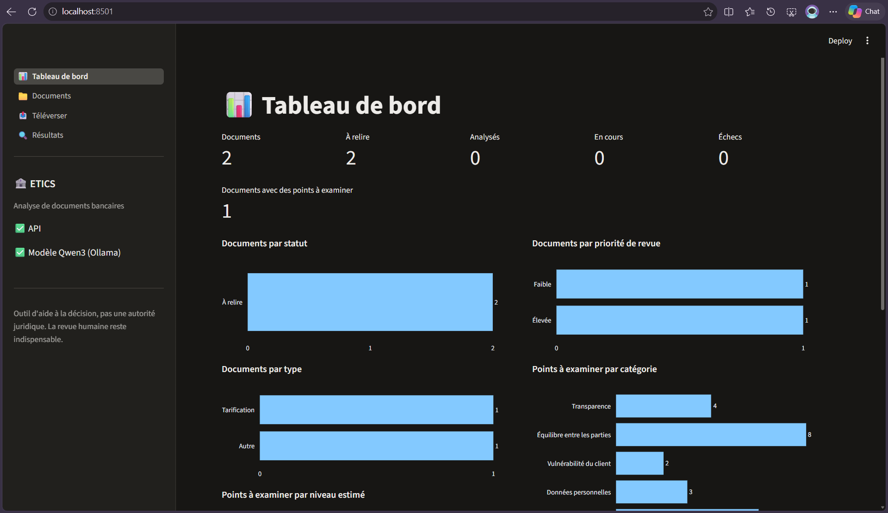
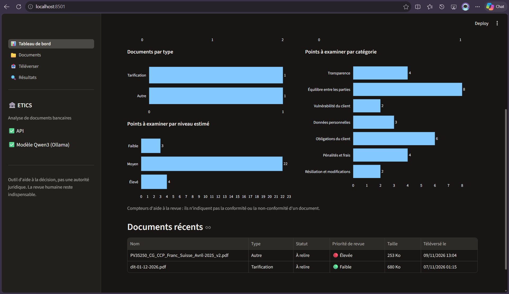
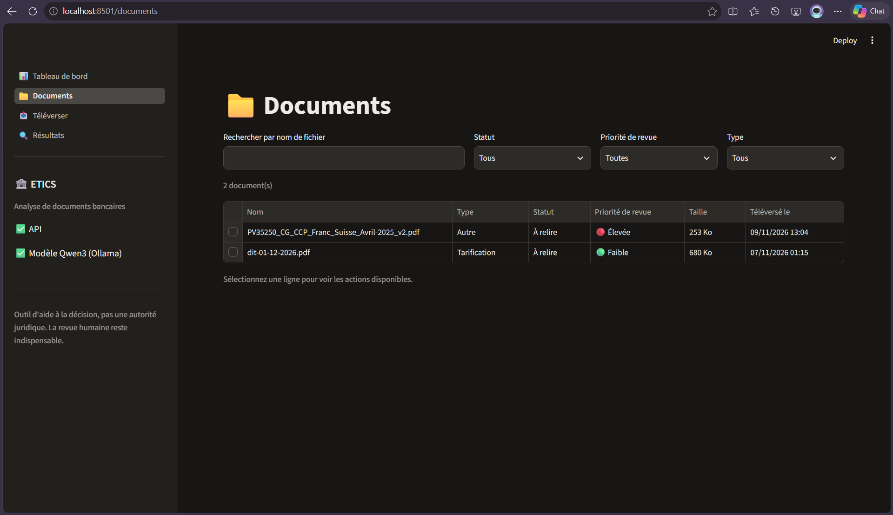
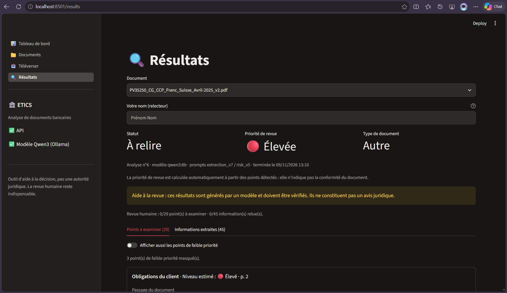
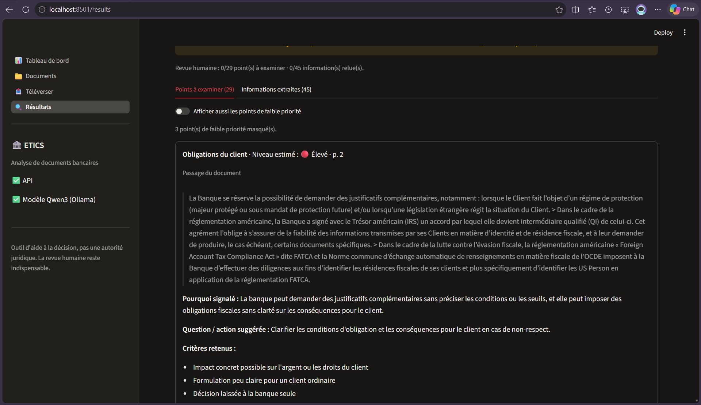
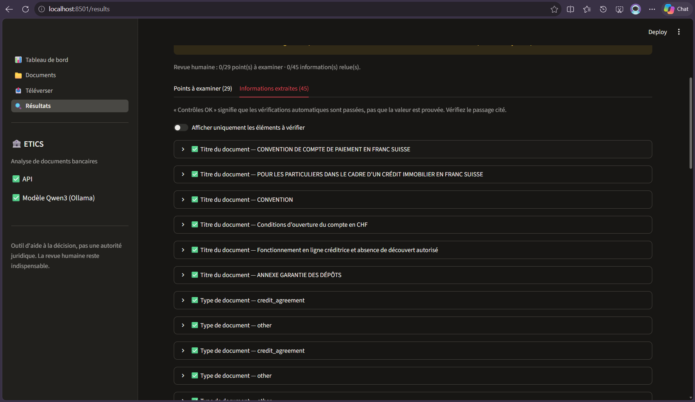
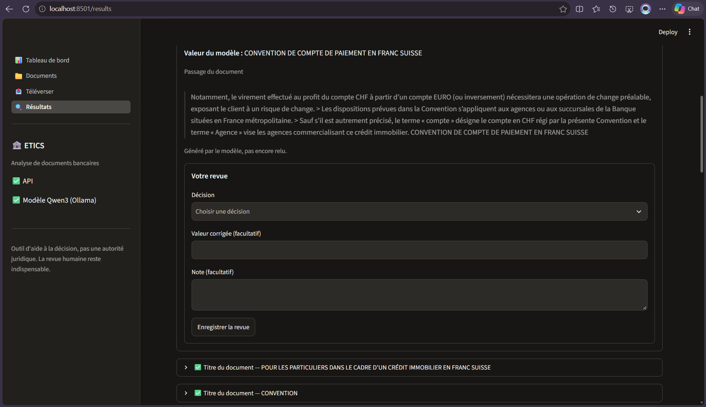
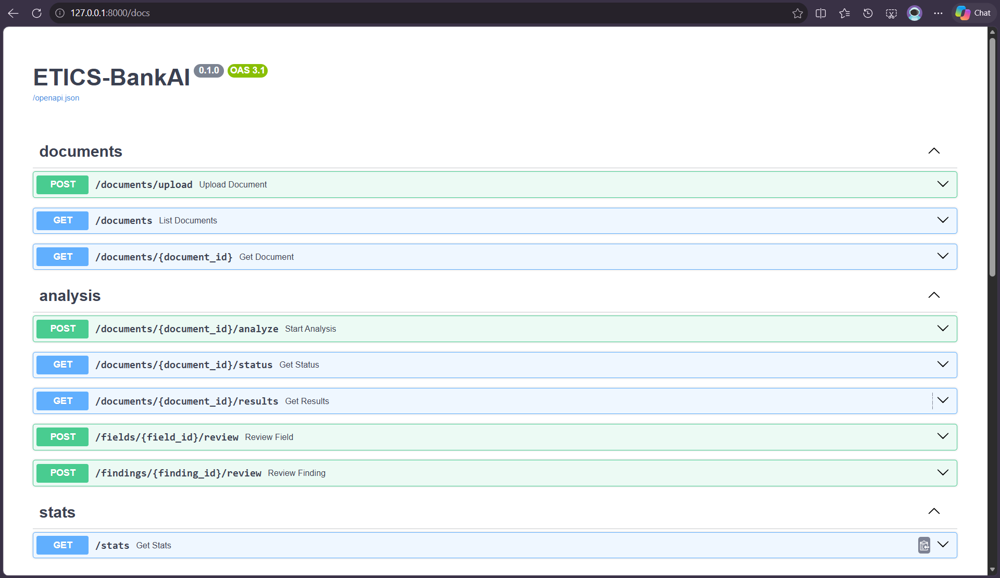
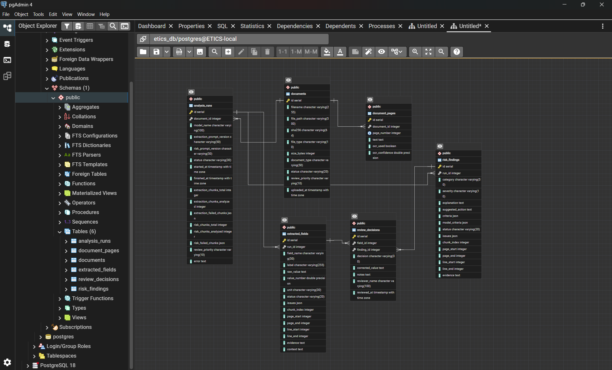
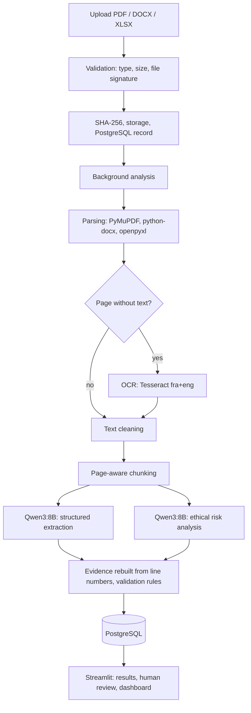

# ETICS-BankAI — Banking Documents Intelligence

> **ETICS-BankAI** is a local-first platform that analyzes banking documents and contracts (PDF, DOCX, XLSX).
> It turns unstructured documents into **structured, traceable data** and highlights **clauses that deserve an ethical review**.
> A human reviewer always keeps the final word.

**ETICS-BankAI is a decision-support tool, not a legal authority.** A flag means *"a human should review this clause"*,
never *"this clause is illegal"* or *"the bank acts unethically"*. An empty result means *"nothing detected in the analyzed passages"*,
never *"the document is compliant"*.

---

## Table of contents

1. [Academic context](#1-academic-context)
2. [Project status](#2-project-status)
3. [Screenshots](#3-screenshots)
4. [Features (V1 — MVP)](#4-features-v1--mvp)
5. [How it works](#5-how-it-works)
6. [Design principles](#6-design-principles)
7. [Tech stack](#7-tech-stack)
8. [Project structure](#8-project-structure)
9. [Installation](#9-installation)
10. [Configuration](#10-configuration)
11. [Running the application](#11-running-the-application)
12. [Using ETICS-BankAI](#12-using-etics-bankai)
13. [API reference](#13-api-reference)
14. [Data model](#14-data-model)
15. [Tests and evaluation scripts](#15-tests-and-evaluation-scripts)
16. [Privacy and security](#16-privacy-and-security)
17. [Known limitations](#17-known-limitations)
18. [Roadmap](#18-roadmap)
19. [Troubleshooting](#19-troubleshooting)
20. [Authors](#20-authors)

---

## 1. Academic context

Annual DATA project (*Projet Annuel DATA*), Master 2 Computer Science **M2EID2**, Université Sorbonne Paris Nord, 2026-2027,
supervised by M. F. Boufarès.

Official topic: *from unstructured data to structured data — LLMs for toxicity detection in contracts and documents*
("Data for Ethics"). The project builds an automated document analysis system that:

- builds a **structured dataset (database)** from the information found in documents;
- tells whether a document contains **potentially problematic ("toxic") content**, with evidence.

In this project, "toxicity" is understood as **contract clauses that may raise ethical concerns while being perfectly legal**:
imbalance between the parties, lack of transparency, unilateral changes, weak protection of vulnerable customers,
unclear use of personal data, and so on.

---

## 2. Project status

| Area | Status |
|---|---|
| Upload, validation, storage (PDF, DOCX, XLSX) | ✅ Implemented |
| Text extraction, table rebuilding, OCR, cleaning, page-aware chunking | ✅ Implemented |
| Structured extraction (14 fields) with verbatim evidence and validation rules | ✅ Implemented |
| Ethical risk analysis with verbatim evidence, severity computed by code, review priority | ✅ Implemented |
| PostgreSQL storage, background pipeline, REST API | ✅ Implemented |
| Streamlit interface: upload, documents list, results, human review, dashboard | ✅ Implemented |
| Export of results (JSON / CSV) | ⏳ Not yet (planned, Phase 10) |
| PDF report | ⏳ Not yet (optional, end of V1) |
| **Measured accuracy** (reference dataset, precision / recall / F1) | ⏳ **Not yet** (planned, Phase 11) |
| Integration tests | ⏳ Not yet |

> **Important:** the quality of the model outputs has **not been measured** yet. The pipeline was checked by manual inspection of
> a limited number of passages. Do not read any result as validated accuracy.

---

## 3. Screenshots

| | |
|---|---|
| **Dashboard** — counters and charts | **Upload** — live analysis progress |
|  |  |
| **Documents** — filters and row actions | **Results** — overview and coverage messages |
|  |  |
| **Points to review** — verbatim passage, page, criteria | **Extracted information** — value, evidence, warnings |
|  |  |
| **Human review** — decision, correction, note | **API documentation** (FastAPI `/docs`) |
|  |  |

Database schema (PostgreSQL, viewed in pgAdmin):



Architecture and data model diagrams:

- [Pipeline and architecture (SVG)](docs/architecture/ETICS-BankAI_Pipeline.svg)
- [Database architecture (SVG)](docs/architecture/ETICS_database_architecture.svg)

---

## 4. Features (V1 — MVP)

**Documents**
- Upload **PDF, DOCX and XLSX** (20 MB maximum by default).
- Validation of the extension, the size and the **file signature** (a `.pdf` file that is not a PDF is refused).
- Original files are stored under their **SHA-256 hash**: the same file is never stored twice.
- Statuses: `uploaded`, `processing`, `processed`, `needs_review`, `failed`.
- List with filters (file name, status, review priority, document type).

**Text processing**
- PDF text extraction page by page (PyMuPDF), **tables rebuilt row by row** so that a label and its amount stay on the same line.
- **OCR** (Tesseract, French + English) for pages with almost no text.
- Text cleaning (spaces, ligatures, hyphenated words, invisible characters) and **page-aware chunking** (about 4,000 characters, 400 overlap).
- DOCX (paragraphs and tables, split on explicit page breaks) and XLSX (one sheet = one page).

**Structured extraction — 14 fields**
`document_title`, `document_type`, `reference_number`, `bank_name`, `issue_date`, `effective_date`, `expiry_date`, `interest_rate`,
`application_fee`, `account_fee`, `commission`, `late_payment_penalty`, `termination_notice_period`, `termination_conditions`.

Each value comes with its **verbatim evidence, page, status** (`valid`, `needs_review`, `rejected`) and the list of issues found by the
validation rules. Loan-specific fields (loan amount, installments, ...) are planned for V2.

**Ethical risk analysis — 8 categories**
`transparency`, `fairness_balance`, `customer_vulnerability`, `privacy_data`, `discrimination`, `customer_obligations`,
`penalties_charges`, `termination_changes`.

Each finding comes with the **verbatim passage, the page, an explanation and a suggested question or action** (in French),
three yes/no criteria, and a **severity estimated by code** (see [Design principles](#6-design-principles)).

**Review and monitoring**
- Human review of every extracted field and every finding: `confirmed`, `not_confirmed`, `needs_more_context`, a note,
  and (for fields) a **corrected value stored next to the model value** — the model value is never overwritten.
- Reviewer name recorded with each decision (no account system in V1).
- Dashboard: counters, charts by status, review priority, document type, finding category and severity.
- Results always show **how much of the document was analyzed** and warn when some passages could not be analyzed.

The interface is in **French**. Documents are expected in **French** (main language) and **English**.

---

## 5. How it works



1. **Upload** — the file is validated, hashed and stored; a record is created in PostgreSQL.
2. **Analysis** (background, one at a time because the model runs on a single GPU)
   - checks that Ollama and the model are available;
   - parses the document, applies OCR where needed, cleans the text, stores the pages, splits the text into chunks;
   - **extraction**: chunks are selected with keywords (the first chunk is always analyzed), Qwen3:8B returns JSON;
   - **risk analysis**: only chunks that contain at least two distinct risk signals (termination, notice, unilateral change,
     liability, personal data, penalties...) are sent to the model;
   - the model answers with **line numbers**; the code rebuilds the **verbatim quote** and its page from them;
   - validation rules normalize values (`2,40` → 2.4, `Gratuit` → 0, `huit jours` → 8 days), set a status and merge duplicates;
   - only the validated results are written to PostgreSQL.
3. **Review** — the user checks the results against the cited passages and records decisions.

Processing times measured so far: a 3-page fee schedule is analyzed in about **48 seconds** on the development machine
(first call after Ollama has been idle: about one minute more to load the model). Times for large documents (dozens of pages)
have **not been measured end to end**; they are expected to be much longer.

---

## 6. Design principles

- **The LLM never writes to the database.** Model output is parsed, validated by Pydantic schemas and by rules, and only then stored.
- **Verbatim evidence, always.** The model returns line numbers, not quotes. The code rebuilds the quote from the document text, so
  an invented or altered quote cannot reach the user. Every result keeps its page and its source passage.
- **Absence is not a negative finding.** If some chunks fail (model error, invalid JSON), the run is stored as
  `completed_with_errors` with the list of failed chunks, and the interface warns that results may be incomplete.
  A field that is missing from a complete analysis is only "not found in the analyzed passages".
- **`valid` does not mean proven.** It means that the automatic checks passed (value found in the evidence, expected topic, format).
  The interface says so, and the reviewer decides.
- **Severity is computed by code.** The model only answers three yes/no questions about each finding: *does it impact the customer's
  money or rights? is it unclear for an ordinary customer? does the bank decide alone?* Code turns them into
  `low` / `medium` / `high` (3 "yes" = high, 2 = medium, 0-1 = low), with a guard: if the quoted text gives the customer a right
  to refuse or leave, "the bank decides alone" is set to false. The model's original answers are stored next to the adjusted ones.
- **Review priority of a document** (`low` / `medium` / `high`) is computed from its findings:
  any `high` → high; any `medium` or at least three `low` → medium; otherwise low; not assessed if the analysis is incomplete.
  It is a review priority, **not** a toxicity or compliance verdict.
- **Model output and human decisions are separate.** Corrections and notes go to `review_decisions`; the raw model output is preserved.
- **Local first.** Documents and results stay on the machine; the model runs locally through Ollama.

---

## 7. Tech stack

| Layer | Technology |
|---|---|
| Language | Python 3.12 |
| Frontend | Streamlit, Plotly |
| Backend | FastAPI, Uvicorn, Pydantic 2, SQLAlchemy 2, psycopg 3 |
| Database | PostgreSQL 18 (installed natively, administered with pgAdmin) |
| LLM runtime and model | Ollama, **Qwen3:8B** (the only model used) |
| Documents | PyMuPDF (PDF, tables), python-docx (DOCX), openpyxl (XLSX) |
| OCR | Tesseract 5 with `fra` and `eng`, pytesseract, Pillow |
| Tests | pytest (SQLite in memory and mocked model for unit tests) |
| HTTP client | httpx |

---

## 8. Project structure

```text
ETICS-BankAI/
├── ai_engine/
│   ├── chunking/            # page-aware chunker, numbered lines sent to the model
│   ├── extraction/          # schemas, chunk selector, extraction service, validation rules
│   ├── llm/                 # Ollama client, JSON client with retries
│   ├── prompts/             # extraction and risk analysis prompts (versioned)
│   ├── toxicity/            # risk schemas, signal-based chunk selector, service, severity rules
│   └── validation/          # evidence rebuilding, value checks, raw LLM output schemas
├── backend/
│   ├── api/                 # documents, analysis (analyze, status, results, review), stats
│   ├── core/                # configuration (environment variables)
│   ├── models/              # SQLAlchemy models
│   ├── schemas/             # API response and request schemas
│   ├── services/            # storage, file validation, repositories, pipeline, progress
│   └── main.py              # FastAPI entry point
├── database/                # engine, session, Base (connection.py)
├── document_processing/
│   ├── ocr/                 # Tesseract OCR
│   ├── parsers/             # PDF, DOCX, XLSX parsers, table rows rebuilding
│   ├── preprocessing/       # text cleaning
│   └── loader.py            # parser dispatch by file type
├── frontend/
│   ├── components/          # API client helpers, labels (French), charts, views, progress
│   ├── pages/               # dashboard, documents, upload, results
│   ├── api_client.py        # HTTP client of the API
│   └── app.py               # Streamlit entry point
├── tests/
│   ├── unit/                # unit tests
│   └── evaluation/          # exploration and measurement scripts (need Ollama and local documents)
├── data/                    # NOT committed: raw uploads, processed text, results, annotations
├── docs/
│   ├── architecture/        # pipeline and database diagrams
│   └── screenshots/         # screenshots used in this README
├── .streamlit/config.toml   # upload size limit, usage statistics disabled
├── .env.example             # environment variables (copy to .env)
├── requirements.txt
└── README.md
```

`docker-compose.yml`, `database/init.sql` and `database/migrations/` are empty placeholders: PostgreSQL is installed natively and the
tables are created at API startup.

---

## 9. Installation

The commands below are for **Windows PowerShell** (the development environment). Reference machine: 8 GB GPU memory and 15 GB RAM.

### Prerequisites

| Tool | Notes |
|---|---|
| Python 3.12 | `python --version` |
| Git | |
| PostgreSQL 18 | installed natively; the `postgresql-x64-18` service must be **running** |
| Ollama | https://ollama.com, then `ollama pull qwen3:8b` (about 5 GB) |
| Tesseract OCR 5 | Windows installer (UB Mannheim); select **French** in *Additional language data*; add the install folder to `PATH` |

Check Tesseract: `tesseract --list-langs` must list `eng` and `fra`.
Check the model: `ollama list` must list `qwen3:8b`.

The model (about 6 GB in memory with a context of 8192 tokens) needs a GPU with **8 GB** of memory or more to run fully on the GPU;
a smaller GPU will work much more slowly.

### Steps

```powershell
git clone <repository-url>
cd ETICS-BankAI

py -3.12 -m venv venv
.\venv\Scripts\Activate.ps1
pip install -r requirements.txt

copy .env.example .env
# edit .env and set DB_PASSWORD (never commit this file)

psql -U postgres -c "CREATE DATABASE etics_db;"
```

If `psql` is not found, add `C:\Program Files\PostgreSQL\18\bin` to your `PATH`.
The tables are created automatically when the API starts.

---

## 10. Configuration

Settings are read from environment variables or from `.env` (never hardcode credentials).

| Variable | Default | Role |
|---|---|---|
| `APP_NAME` | `ETICS-BankAI` | Application name |
| `APP_ENV` | `development` | Environment name |
| `DB_HOST` / `DB_PORT` | `localhost` / `5432` | PostgreSQL server |
| `DB_NAME` | `etics_db` | Database name |
| `DB_USER` | `postgres` | Database user |
| `DB_PASSWORD` | *(required)* | Database password |
| `OLLAMA_BASE_URL` | `http://localhost:11434` | Ollama server |
| `OLLAMA_MODEL` | `qwen3:8b` | Model name |
| `OLLAMA_NUM_CTX` | `8192` | Context size (tokens) |
| `OLLAMA_TIMEOUT` | `300` | Timeout of one model call (seconds) |
| `OLLAMA_MAX_TOKENS` | `3000` | Output limit of one call (protects against repetition loops) |
| `DATA_DIR` | `data` | Data folder (uploads are stored in `data/raw/uploads`) |
| `MAX_UPLOAD_MB` | `20` | Maximum upload size |
| `API_BASE_URL` | `http://127.0.0.1:8000` | API address used by the Streamlit interface |

---

## 11. Running the application

Use **three terminals**, each with the virtual environment activated (`.\venv\Scripts\Activate.ps1`), from the project root.
Leave the first two open while you use the application.

**Terminal 1 — API**

```powershell
uvicorn backend.main:app
```

Do not use `--reload` while an analysis is running: restarting the server interrupts it
(interrupted analyses are marked as `failed` at the next start).

**Terminal 2 — interface**

```powershell
python -m streamlit run frontend/app.py
```

Streamlit opens http://localhost:8501. The sidebar shows whether the API and the model are available.
If Windows asks about the firewall, you can cancel: everything runs locally.

**Terminal 3** — free for tests and Git commands.

Interactive API documentation: http://127.0.0.1:8000/docs

If you restart the computer, check that the PostgreSQL service is running
(administrator PowerShell: `Start-Service postgresql-x64-18`) and that Ollama is running.

---

## 12. Using ETICS-BankAI

1. **Upload** (*Téléverser*) — choose a PDF, DOCX or XLSX file and click *Téléverser le document*.
   If an identical file already exists, you are told and it is not stored twice.
2. **Analyze** — click *Lancer l'analyse*. A progress bar shows the current stage
   (reading, extraction, risk analysis). The analysis runs in the background; you can leave the page.
3. **Documents** — list with filters; select a row to open its results or to launch or relaunch an analysis.
4. **Results** (*Résultats*)
   - header: status, review priority, document type, model and prompt versions;
   - messages about coverage (failed passages, no signal found);
   - **Points à examiner**: for each finding, the verbatim passage, the page, the category, the estimated level, the explanation,
     the suggested question and the criteria. Low-priority findings are hidden by default;
   - **Informations extraites**: each field with its value, evidence, page and warnings.
5. **Review** — enter your name, then for each finding or field choose a decision, add a note and, for a field, an optional
   corrected value. The model value stays visible and unchanged.
6. **Dashboard** (*Tableau de bord*) — counters and charts over the whole collection.

### Using the API directly

```powershell
curl.exe -F "file=@path\to\document.pdf" http://127.0.0.1:8000/documents/upload
curl.exe -X POST http://127.0.0.1:8000/documents/1/analyze
curl.exe http://127.0.0.1:8000/documents/1/status
curl.exe http://127.0.0.1:8000/documents/1/results
```

---

## 13. API reference

| Method | Route | Role |
|---|---|---|
| `GET` | `/health` | API status |
| `GET` | `/health/ollama` | Ollama status and model availability |
| `POST` | `/documents/upload` | Upload a document (validation, hashing, duplicate detection) |
| `GET` | `/documents` | List documents; filters: `status`, `review_priority`, `document_type`, `q` (file name) |
| `GET` | `/documents/{id}` | One document |
| `POST` | `/documents/{id}/analyze` | Start the analysis in the background (`202`; `409` if already running) |
| `GET` | `/documents/{id}/status` | Status and progress |
| `GET` | `/documents/{id}/results` | Latest analysis: fields, findings, reviews, `analysis_complete`, notice |
| `POST` | `/fields/{id}/review` | Human decision on an extracted field (optional correction) |
| `POST` | `/findings/{id}/review` | Human decision on a finding |
| `GET` | `/stats` | Counters used by the dashboard |

The progress of a running analysis is kept in memory (lost if the server restarts); final results are stored in PostgreSQL.

---

## 14. Data model

Six tables (diagram: [docs/architecture/ETICS_database_architecture.svg](docs/architecture/ETICS_database_architecture.svg)):

| Table | Content |
|---|---|
| `documents` | File metadata, SHA-256, status, document type, review priority |
| `document_pages` | Text of every page (with OCR information) |
| `analysis_runs` | One row per analysis: model, prompt versions, status, chunk counters, failed chunks, error |
| `extracted_fields` | Extracted values with raw model value, normalized number, unit, status, issues, page, evidence |
| `risk_findings` | Findings with category, severity, criteria (adjusted and original), page, evidence |
| `review_decisions` | Human decisions on **one** field or **one** finding (enforced by a constraint), correction, note, reviewer, date |

Re-analyzing a document creates a new run; previous runs are kept, and the interface and the dashboard use the latest one.

> The tables are created with `create_all` at startup, which does not modify an existing table. During development, a changed table
> must be dropped and recreated. Migrations (Alembic) are planned for later versions.

---

## 15. Tests and evaluation scripts

**Unit tests** (no Ollama and no PostgreSQL needed: in-memory SQLite and a mocked model):

```powershell
python -m pytest tests/unit -q
```

They cover parsers, OCR, cleaning, chunking, evidence rebuilding, validation rules, severity rules, repositories, the pipeline,
the API, the API client, labels and view helpers. The Streamlit pages themselves are not covered by automated tests.

**Evaluation and exploration scripts** (`tests/evaluation/`) need Ollama and documents placed in `data/raw/`
(not included in the repository):

| Script | Purpose |
|---|---|
| `check_corpus.py` | Parse, clean and chunk every PDF of `data/raw` (pages, characters, OCR pages, chunks, time) |
| `check_selection.py`, `check_risk_selection.py` | Share of chunks selected for extraction and for risk analysis |
| `try_llm.py <file> <chunk>` | Raw model output on one chunk, with evidence checks |
| `try_extraction.py <file>` | Extraction on a whole document with statuses |
| `try_risk.py <file> [chunk]` | Risk analysis with criteria and severity |
| `try_pipeline.py <document id>` | Full pipeline on a stored document with progress |
| `smoke_db.py` | Repository functions against the real PostgreSQL database |

---

## 16. Privacy and security

- Documents, extracted data and the model stay **on the local machine**; nothing is sent to an external service.
- `.env`, uploaded documents and generated data are excluded from Git (`.gitignore`). Never commit banking documents.
- Logs and stored error messages contain exception types only, **never document content**.
- Use **public, synthetic or anonymized** documents for demonstrations and screenshots.
- V1 has **no authentication**: the reviewer name is a free text field. Run it on a trusted machine only.
- Files are not encrypted at rest and there is no retention or deletion policy yet.

---

## 17. Known limitations

- **Model quality is not measured.** Qwen3:8B can return wrong categories, incomplete explanations, wrong line numbers
  or false positives, and can miss clauses (recall is unknown). Validation rules catch some errors, not all.
- **Risk findings are limited** to three per chunk, and chunks are selected with keyword signals that may skip relevant passages.
- **Analysis is chunk by chunk**: problems that need the whole document (information spread over several places,
  something that is missing from the document) are not detected.
- **Severity is an estimate** from three yes/no answers, with a few rules built from a small number of examples.
- **Tables:** table rebuilding works on the documents tested; layouts without clear structure may still give poorly aligned rows.
  Sometimes the model quotes the line before or after the right one; such fields are flagged `needs_review` rather than corrected.
- **Speed:** one analysis at a time, in the API process; large documents can take a long time.
- **Languages:** French and English only (no Arabic in V1).
- **No export yet**, no authentication, no migrations, and the original page is not displayed (only its number).
- The progress of a running analysis is lost if the server restarts (the analysis is then marked as failed).

---

## 18. Roadmap

**Before the end of V1**
- Export of results in JSON and CSV (with model observations and human decisions clearly separated); PDF report if time allows.
- Evaluation: a small human-annotated reference set (extraction and risk detection evaluated separately), precision / recall / F1,
  error analysis, and prompt improvements measured against it.
- Integration tests and final documentation.

**V2 ideas**
- Document-type profiles (fields depending on the kind of document) and loan-specific fields.
- Verification pass on findings (does the quote support the explanation?).
- Displaying the original page with the quote highlighted.
- RAG question answering with page citations, semantic search, comparison of contracts, batch processing.
- Authentication and roles, Alembic migrations, Arabic documents.

---

## 19. Troubleshooting

| Symptom | Likely cause and fix |
|---|---|
| Interface shows *API indisponible* | The API is not running: start `uvicorn backend.main:app` in its own terminal |
| `ConnectionTimeout` to `localhost:5432` | PostgreSQL service stopped: `Start-Service postgresql-x64-18` in an administrator PowerShell |
| `No module named streamlit` (or another package) | The virtual environment is not activated (the prompt has no `(venv)`): `.\venv\Scripts\Activate.ps1`, then `pip install -r requirements.txt` |
| Sidebar shows ⚠️ for the model | Ollama is not running or `qwen3:8b` is not installed (`ollama list`) |
| `tesseract` not recognized | Add the Tesseract folder to `PATH` and open a new terminal; check `tesseract --list-langs` |
| An analysis stays `En attente` | Another analysis is running (one at a time) |
| An analysis ends `failed` | See the error in the status (`GET /documents/{id}/status`); no document content is stored in it |
| Windows firewall pop-up when starting Streamlit | You can cancel: the application is only used locally |

---

## 20. Authors

Project owner: **Wassim** — Master 2 student, WISD (FSDM Fès) / M2EID2 (Université Sorbonne Paris Nord).

Supervisor: M. F. Boufarès.

*(Add the other members of the team, the repository link and the license here.)*
